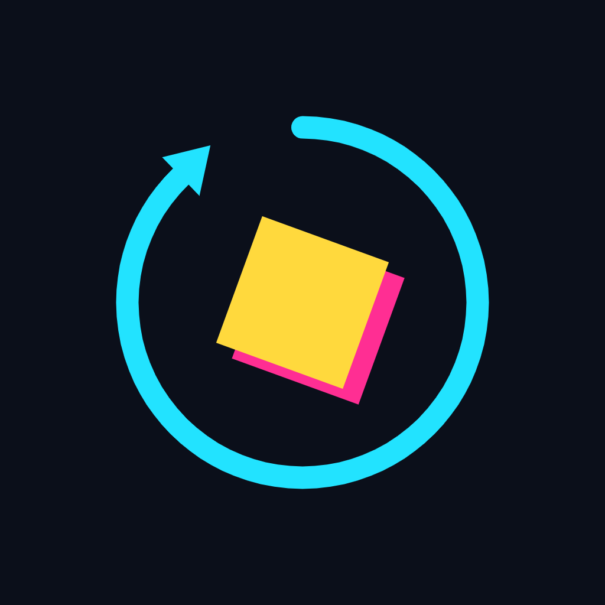
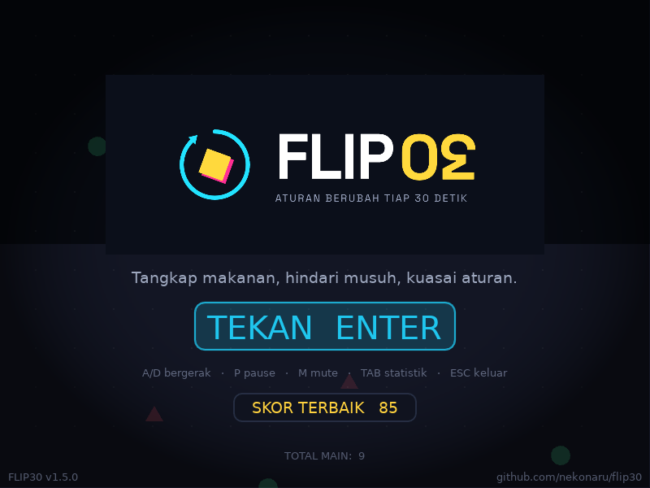
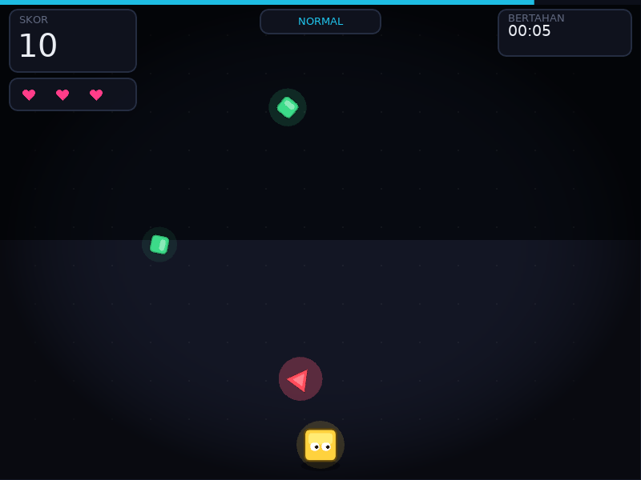

<div align="center">
  
  <h1>Flip30: Aturan Berganti Setiap 30 Detik</h1>
  <p><b>Tangkap makanan, hindari musuh, dan beradaptasi setiap 30 detik<br/>saat aturan berubah di depan matamu.</b></p>

  <a href="https://github.com/nekonaru/flip30/releases"></a>
  <a href="https://github.com/nekonaru/flip30/actions/workflows/ci.yml"></a>
  
  
  
  
  
</div>

<br />

[English](README.md) | **Bahasa Indonesia**

> [!NOTE]
> Flip30 berjalan di LÖVE 11.5, sebuah engine 2D gratis dan open source. Untuk bermain, kamu cukup unduhan Windows siap pakai (sudah termasuk semua), atau instalasi LÖVE 11.5 satu kali.

---

## Table of Contents

- [Tentang](#tentang)
- [Tangkapan Layar](#tangkapan-layar)
- [Fitur](#fitur)
- [Kebutuhan](#kebutuhan)
- [Instalasi](#instalasi)
- [Cara Main](#cara-main)
- [Struktur Proyek](#struktur-proyek)
- [Pengembangan](#pengembangan)
- [Pengujian](#pengujian)
- [Integrasi Berkelanjutan](#integrasi-berkelanjutan)
- [FAQ](#faq)
- [Penulis](#penulis)
- [Lisensi](#lisensi)

---

## Tentang

**Flip30** adalah game arcade survival kecil tentang beradaptasi lebih cepat daripada perubahan yang dilakukan game. Kamu menggeser sebuah sticky note di bagian bawah layar, menangkap makanan dan menghindari musuh, dan setiap 30 detik seluruh aturan permainan diganti dengan aturan acak yang baru. Semuanya berjalan secara lokal, tanpa akun dan tanpa koneksi internet.

> _"Aturan berubah setiap 30 detik."_

---

## Tangkapan Layar

| Menu | Gameplay |
| --- | --- |
|  |  |

---

## Fitur

### Gameplay inti

| Fitur | Deskripsi |
| --- | --- |
| **Player** | Geser sticky note 40x40 dengan A/D atau tombol panah, tertahan di dalam arena. Mata mengikuti arah gerakmu |
| **Objek** | Makanan hijau bernilai +10 poin, makanan keemasan adalah drop langka bernilai +50, tidak terpengaruh TUKAR WARNA. Musuh merah mengurangi 1 nyawa, dimainkan di kanvas 800x600 |
| **Kesulitan** | Kecepatan jatuh dan laju spawn naik seiring waktu; kamu punya tiga nyawa per sesi |
| **Skor terbaik** | Skor tertinggi disimpan secara lokal di `highscore.txt`, dirayakan saat rekor baru |
| **Timer bertahan** | HUD menampilkan berapa lama kamu bertahan, mm:ss |
| **Combo** | Setiap 4 tangkapan berturut-turut menaikkan multiplier sampai x5; kena musuh meresetnya |
| **Statistik** | Tekan TAB di menu untuk melihat statistik sepanjang waktu: total main, total waktu bertahan, total skor, total makanan, skor terbaik, combo terbaik |
| **Dua aturan di menit kedua** | Setelah menit ke-2, dua aturan aktif bersamaan; keduanya tidak boleh punya tag yang sama |
| **Pause** | Tekan P untuk menjeda aksi, tekan P lagi untuk lanjut |
| **Mute** | Tekan M untuk membisukan SFX, di mana pun |

### Aturan yang berganti timer

| Fitur | Deskripsi |
| --- | --- |
| **Ganti aturan 30 detik** | Setiap 30 detik aturan yang aktif di-revert dan aturan acak baru di-apply |
| **Lima belas aturan** | KONTROL TERBALIK, GRAVITASI MATI, GRAVITASI NAIK, MUSUH JADI POIN, TUKAR WARNA, LAYAR GELAP, SEMUA 2X CEPAT, TIDAK BISA BERHENTI, HUJAN, SKOR GANDA, BESAR, KECIL, GRAVITASI TURBULEN, HANTU, WAKTU LAMBAT |
| **Pilihan adil** | Aturan yang sama tidak pernah aktif dua kali berturut-turut; aturan dengan tag yang sama tidak pernah aktif bersamaan |
| **Banner pengumuman** | Banner besar selama dua detik saat action melambat ke 0.3x |
| **Progress bar** | Bar timer tipis di bagian atas layar |

### Tampilan dan rasa

| Fitur | Deskripsi |
| --- | --- |
| **Juice** | Sparkle, screen shake, popup skor melayang, hitungan skor bertahap, kilat merah saat kena hit, dan denyut merah saat nyawa tinggal satu |
| **Combo milestone** | Popup "COMBO x2 / x3 / x4 / x5" muncul saat streakmu melewati ambang tertentu |
| **Suara** | SFX disintesis saat load time, tidak butuh file audio |

### Modding

| Fitur | Deskripsi |
| --- | --- |
| **Aturan sebagai data** | Setiap aturan adalah satu file Lua di `rules/`, tanpa mengubah engine |
| **Mod tersandbox** | Aturan tambahan di folder `rules/` direktori save berjalan tanpa akses `os`, `io`, atau `love` |
| **Contoh mod** | `examples/rules/gerak_pelan.lua`, aturan setengah kecepatan untuk disalin sebagai titik awal |

### Pengembangan

| Fitur | Deskripsi |
| --- | --- |
| **Test headless** | 261 assertion berjalan di bawah LuaJIT di CI |
| **Kode terformat** | StyLua diwajibkan secara lokal dan di CI |
| **Mode artwork** | Capture `--screenshot` deterministik yang dipakai di README ini |
| **Kanvas responsif** | Virtual canvas 800x600 di-letterbox ke ukuran jendela apa pun |
| **Open source** | Lisensi MIT |

---

## Kebutuhan

| Dependency | Versi Minimum | Catatan |
| --- | --- | --- |
| **LÖVE** | 11.x (diuji di 11.5) | Dibutuhkan untuk jalan dari source dan untuk membuka build `.love` |
| **Windows** | 7 atau lebih baru, 64-bit | Unduhan siap pakai sudah termasuk semua, tidak perlu instal LÖVE |
| **Linux / macOS** | versi apa pun yang didukung | Perlu instal LÖVE satu kali |
| **Keyboard** | A/D atau tombol panah, Enter, Esc | Mouse tidak diperlukan |
| **Akun** | Tidak ada | Skor terbaik tersimpan di mesinmu |

> [!TIP]
> Kalau kamu hanya ingin bermain, unduh build siap pakai dari halaman [Releases](https://github.com/nekonaru/flip30/releases). Kamu tidak butuh apa-apa lagi.

### Belum pernah pakai terminal? Mulai dari sini

<details>
<summary><b>Cara membuka terminal di Windows</b></summary>

1. Tekan tombol **Windows**, ketik `PowerShell`, lalu tekan **Enter**
2. Jendela terbuka. Itulah tempat kamu mengetik perintah
3. Setiap perintah di panduan ini diketik di jendela itu, diikuti **Enter**

</details>

---

## Instalasi

### Opsi A: Unduh build siap pakai (paling mudah)

1. Buka halaman [Releases](https://github.com/nekonaru/flip30/releases)
2. Unduh `flip30-1.5.0-win64.zip` di Windows, atau `flip30-1.5.0.love` di platform lain
3. Windows: extract zip ke mana saja lalu jalankan `Flip30.exe`. Platform lain: instal LÖVE 11.5, lalu jalankan `love flip30-1.5.0.love`

> [!IMPORTANT]
> Gunakan `flip30-1.5.0-win64.zip` di Windows. Gunakan `flip30-1.5.0.love` hanya dengan instalasi LÖVE 11.5 terpisah.

### Opsi B: Build dari source (untuk development / untuk membaca atau mengubah kode)

#### 1. Dapatkan kode proyeknya

<details>
<summary><b>Saya punya Git terpasang</b></summary>

```bash
git clone https://github.com/nekonaru/flip30.git
cd flip30
```

</details>

<details>
<summary><b>Saya tidak punya Git</b></summary>

1. Buka halaman repository di GitHub
2. Klik tombol hijau **`Code`**, lalu pilih **`Download ZIP`**
3. Extract ZIP ke folder pilihanmu
4. Di terminal, masuk ke folder yang sudah di-extract, contohnya:

```bash
cd flip30-main
```

</details>

#### 2. Instal dependensi dan verifikasi

Instal LÖVE 11.5, lalu cek versi yang tercetak:

```powershell
love --version
```

Di Windows, cara tercepat adalah `winget install --id Love2d.Love2d -e`.

> [!IMPORTANT]
> `love --version` harus mencetak `LOVE 11.x` (disarankan 11.5) sebelum kamu lanjut.

#### 3. Jalankan

```sh
love .
```

Menu terbuka dan game langsung bisa dimainkan. Untuk menghasilkan artifact rilis (`.love` archive dan build Windows), jalankan `scripts/build.ps1 -Version 1.5.0` di Windows.

---

## Cara Main

### Peluncuran pertama

1. Buka game dengan `love .` atau lewat unduhan siap pakai
2. Menu muncul. Tekan **Enter** atau **Space** untuk mulai
3. Game normal dimulai. Pergantian aturan pertama terjadi di t = 30 detik

> [!NOTE]
> Teks UI menggunakan Bahasa Indonesia. Game bisa dimainkan tanpa membaca: hijau itu bagus, merah itu bahaya.

### Pemakaian sehari-hari

- **Bergerak**: A/D atau tombol panah
- **Pause**: P untuk menjeda, P untuk lanjut; ESC ke menu
- **Mute**: M, di mana pun
- **Tangkap makanan**: catatan hijau, +10 poin, dan streak combo naik sampai x5
- **Hindari musuh**: segitiga merah, -1 nyawa, kamu mulai dengan 3
- **Bertahan**: makin lama kamu bertahan, makin cepat gamenya; setelah menit ke-2 dua aturan bisa aktif bersamaan
- **Main lagi**: Enter atau Space di layar game over; Esc kembali ke menu atau keluar
- **Skor terbaik**: tampil di menu dan layar game over; tersimpan otomatis
- **Statistik**: TAB di menu membuka panel statistik sepanjang waktu
- **Makanan keemasan**: pickup langka bernilai +50 poin, tidak terpengaruh TUKAR WARNA

---

## Struktur Proyek

```
flip30/
  main.lua            # LÖVE entry point, mode artwork --screenshot, --force-rule
  conf.lua            # Window, identity, ikon, versi LÖVE
  src/
    game.lua          # State machine (menu, playing, gameover), letterboxing
    player.lua        # Gerak sticky note 40x40
    spawner.lua       # Spawn FOOD/ENEMY, kurva kesulitan, collision
    world.lua         # Parameter world yang bisa diubah dan scaling kesulitan
    rulemanager.lua   # Pemuatan, pemilihan, apply/revert aturan, timer 30 detik
    modloader.lua     # Pemuatan mod tersandbox dari direktori save
    ui.lua            # HUD, banner, popup, hearts, menu, game over
    storage.lua       # Skor terbaik via love.filesystem (highscore.txt)
    particles.lua     # Sparkle burst, sprite dihasilkan sendiri
    sfx.lua           # SFX disintesis, tanpa file audio
  rules/              # Satu file per aturan, berganti otomatis tiap 30 detik
  assets/
    brand/            # Logo, ikon, artwork monokrom
    screenshots/      # Capture dalam game dari mode screenshot
  examples/rules/     # Contoh mod untuk disalin ke direktori save
  tests/              # Test suite headless LuaJIT
  scripts/            # build.ps1 dan build.sh, builder artifact rilis
  docs/               # Panduan modding, proses rilis, PRD
  stylua.toml         # Konfigurasi formatter, dipakai lokal dan di CI
  README.md           # Dokumentasi (English)
  README.id.md        # Dokumentasi (Bahasa Indonesia)
```

---

## Pengembangan

### Menambahkan aturan baru

1. Buat `rules/my_rule.lua` dengan `name`, `tags`, `apply`, dan `revert`
2. `apply` dan `revert` harus saling kebalikan secara tepat
3. Tambahkan file tersebut ke `bundled_rule_files` di `tests/headless_tests.lua`
4. Jalankan `luajit tests/headless_tests.lua`

> [!NOTE]
> Engine memuat otomatis setiap aturan di `rules/`; hanya empat langkah di atas yang dibutuhkan.

### Menghasilkan ulang screenshot

```sh
love . --screenshot shots/menu.png --frames 0
love . --screenshot shots/gameplay.png --frames 260
love . --screenshot shots/dark.png --frames 60 --force-rule "LAYAR GELAP"
```

### Overlay debug

```sh
love . --debug
```

Tekan I untuk menampilkan atau menyembunyikan overlay. Overlay menampilkan FPS, draw call, canvas switch, objek aktif, dan memori tekstur.

---

## Pengujian

Verifikasi sebelum setiap push:

```bash
luajit tests/headless_tests.lua
stylua --check .
```

| Check | Requirement |
| --- | --- |
| `luajit tests/headless_tests.lua` | Semua 261 assertion lolos |
| `stylua --check .` | Tidak ada output (tidak ada diff) |

Formatting dikonfigurasi di `stylua.toml`.

---

## Integrasi Berkelanjutan

| Workflow | Purpose |
| --- | --- |
| `ci.yml` | Menjalankan test suite headless (LuaJIT) dan `stylua --check .` pada setiap push dan pull request |

Command lokal sama dengan CI, jadi hijau secara lokal berarti hijau juga di GitHub.

---

## FAQ

<details>
<summary><b>Kenapa gamenya terus berganti aturan?</b></summary>

Itu memang gamenya. Setiap 30 detik aturan yang berbeda diterapkan, dan intinya adalah belajar aturan baru dengan cepat.

</details>

<details>
<summary><b>Di mana skor terbaik saya disimpan?</b></summary>

Di `highscore.txt` di dalam save directory app (contoh `%APPDATA%\love\flip30` di Windows). File ini bertahan meskipun game ditutup.

</details>

<details>
<summary><b>Bisakah saya menambahkan aturan sendiri?</b></summary>

Bisa. Taruh file `.lua` di folder `rules` di dalam save directory. Lihat [docs/modding.md](docs/modding.md) untuk kontrak aturan dan contoh lengkap.

</details>

<details>
<summary><b>Apakah game ini butuh internet?</b></summary>

Tidak. Semuanya berjalan secara lokal, termasuk skor terbaik.

</details>

<details>
<summary><b>Bagaimana cara melaporkan bug?</b></summary>

Buka issue dengan platform kamu, output dari `love --version`, dan apakah ada mod yang dimuat.

</details>

---

## Penulis

<div align="center">

| [](https://github.com/nekonaru) |
|:---:|
| **Nicolas Dwi Dharma** |
| [github.com/nekonaru](https://github.com/nekonaru) |

</div>

---

## Lisensi

Didistribusikan dengan **Lisensi MIT**. Lihat [`LICENSE`](LICENSE) untuk informasi lebih lanjut.
