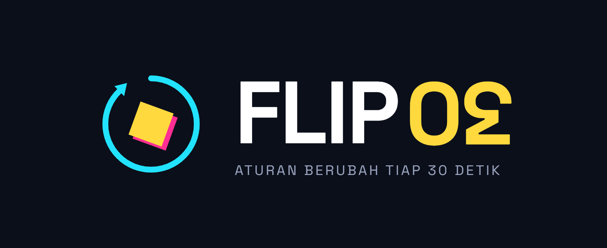
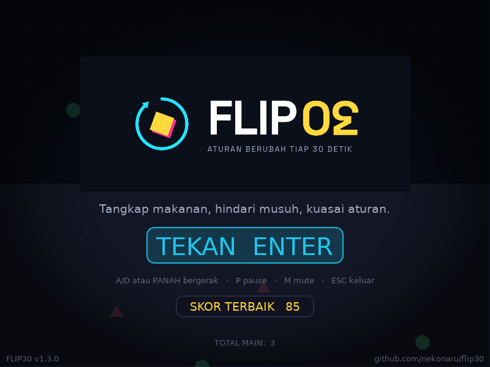
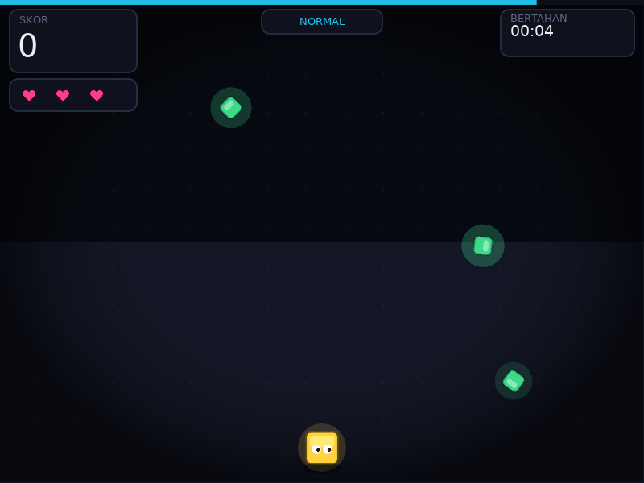
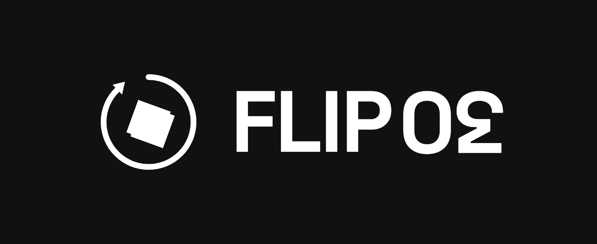

<div align="center">
  

  # Flip30

  **Aturan berubah tiap 30 detik.** *(The rules change every 30 seconds.)*

  A fast arcade game for [LÖVE](https://love2d.org) 11.x: you slide a sticky
  note along the bottom of the screen, catching food and dodging enemies — but
  every 30 seconds the rules of reality are swapped for a new, random one.

  [](https://github.com/nekonaru/flip30/actions/workflows/ci.yml)
  [](https://github.com/nekonaru/flip30/releases/latest)
  [](LICENSE)
  [](https://love2d.org)
  [](https://www.lua.org)
  [](https://github.com/JohnnyMorganz/StyLua)
</div>

---

## About

Flip30 is a tiny, complete arcade game about adapting faster than your opponent.
It starts off innocent enough: catch the green food, dodge the red enemies, beat
your high score. Then the **Rule Manager** flips the entire rule set on a 30
second timer, and suddenly control is reversed, gravity is dead, or touching
enemies is worth points.

Every rule is a single, self-contained Lua file in [`rules/`](rules) — adding a
new rule never touches the core engine. See [docs/modding.md](docs/modding.md)
to write your own.

## Screenshots

<div align="center">
  
  
</div>

## How to play

| Input | Action |
| --- | --- |
| `A` / `←` | Move left |
| `D` / `→` | Move right |
| `Enter` / `Space` | Start / restart |
| `Esc` | Back to menu / quit |

- **Food (green)** → `+10` score
- **Enemy (red)** → `-1` life (you start with **3**)
- Every **30 seconds** the current rule is reverted and a random new one is
  applied. The banner announces it; the action briefly slows to 0.3x.
- Survive as long as you can. Your best score is saved locally.

## The rules

| Rule | Effect |
| --- | --- |
| `KONTROL TERBALIK` | Controls are reversed — left is right and right is left. |
| `GRAVITASI MATI` | Objects float down extremely slowly. |
| `GRAVITASI NAIK` | Objects fall from the bottom upwards. |
| `MUSUH JADI POIN` | Touching enemies scores `+15`. Enemies that leave the screen cost `-5`. |
| `TUKAR WARNA` | Food and enemy colors are swapped. Behaviour is unchanged — your eyes lie. |
| `LAYAR GELAP` | Only a small circle of light around the player is visible. |
| `SEMUA 2X CEPAT` | Everything moves twice as fast: fall speed, spawn rate, the player. |
| `TIDAK BISA BERHENTI` | The player can never stop moving. |

The first rule of the run is applied after 30 seconds; before that you play a
normal game. Rules never repeat back-to-back, and rules that share a `tag`
(e.g. two `gravity` rules) are never active simultaneously.

## Download & run

### Play the release build

Grab the latest **`flip30-x.y.z.love`** from
[GitHub Releases](https://github.com/nekonaru/flip30/releases) and run it with
[LÖVE 11.5](https://love2d.org):

```sh
love flip30-1.0.0.love
```

A Windows build (`flip30-1.0.0-win64.zip`, no install required) is attached to
every release as well.

### Run from source

```sh
git clone https://github.com/nekonaru/flip30.git
cd flip30
love .
```

Requires LÖVE 11.x (developed against 11.5). No other dependencies.

## Development

### The dev tools

Everything in this repo was built and is checked with the following toolchain.

| Tool | Version | Used for | Install (Windows) |
| --- | --- | --- | --- |
| [LÖVE](https://love2d.org) | 11.5 | Running the game, `--screenshot` artwork mode | `winget install Love2d.Love2d` |
| [LuaJIT](https://luajit.org) | 2.1 | Headless test suite — the same Lua VM LÖVE ships | `winget install DEVCOM.LuaJIT` |
| [StyLua](https://github.com/JohnnyMorganz/StyLua) | 2.5.2 | Lua formatting (`stylua.toml`) | `winget install JohnnyMorganz.StyLua` |
| [GitHub Actions](https://github.com/nekonaru/flip30/actions/workflows/ci.yml) | — | CI: `luajit tests/headless_tests.lua` + `stylua --check .` on every push and PR | — |
| [GitHub CLI](https://cli.github.com) | 2.x | Releases (`gh release create` / `gh release download`) | `winget install GitHub.cli` |
| Git + Conventional Commits | — | History; see [CONTRIBUTING.md](CONTRIBUTING.md) | — |

On Linux/macOS, install the equivalents from your package manager or the
respective project pages.

```sh
love .                                # run the game
luajit tests/headless_tests.lua       # 193 headless assertions
stylua .                              # format all Lua sources
stylua --check .                      # what CI runs
love . --screenshot shot.png --frames 480   # regenerate artwork deterministically
love . --screenshot shot.png --frames 60 --force-rule "LAYAR GELAP"
```

Local commands and CI are the same three: run the game, run the tests, check
formatting. If CI is green locally, it is green on GitHub.

### Project layout

```
flip30/
  main.lua            -- LÖVE entry point (+ --screenshot artwork mode)
  conf.lua            -- window, identity, icon, LÖVE version
  src/
    game.lua          -- state machine (menu/playing/gameover), letterboxing
    player.lua        -- 40x40 sticky-note player movement
    spawner.lua       -- FOOD/ENEMY spawns, difficulty curve, collisions
    world.lua         -- all mutable world parameters + difficulty scaling
    rulemanager.lua   -- rule loading, selection, apply/revert, 30s timer
    modloader.lua     -- sandboxed mod loading from the save directory
    ui.lua            -- HUD, banner, popups, hearts, menu, game over
    storage.lua       -- high score via love.filesystem (highscore.txt)
    particles.lua     -- sparkle bursts (generated sprite)
    sfx.lua           -- synthesized SFX (no audio files)
  rules/              -- one file per rule, hot-swapped every 30 seconds
  assets/brand/       -- logo, icon, monochrome artwork
  assets/screenshots/ -- in-game captures (deterministic --screenshot mode)
  examples/rules/     -- example mod to copy into your save directory
  tests/              -- headless LuaJIT test suite
  scripts/            -- build.ps1 / build.sh release artifact builders
  docs/               -- modding guide, release process, PRD
  stylua.toml         -- formatter config (used locally and in CI)
```

### Design decisions (PRD open questions, resolved simply)

- **No rule is active at run start** — the first flip happens at t = 30s, so a
  new player learns the base game first.
- **Escape penalty floors at 0** — `MUSUH JADI POIN` can reduce your score to
  zero but never below it.
- **`world.elapsed` is not reset between rule swaps** — the difficulty curve is
  a function of total play time, not of the current rule.
- **UI text is Indonesian** (matching the game's tagline); code and docs are English.
- **Default font only** — no external font files; the brand artwork carries the identity.
- **Music is out of scope for v1.0** — SFX are synthesized at load; no assets needed.
- **Resize letterboxing** — the game renders to a fixed 800x600 virtual canvas,
  scaled to fit any window size with black bars.

## Contributing

See [CONTRIBUTING.md](CONTRIBUTING.md). Adding a rule is the easiest first
contribution: one file in `rules/`, no core changes. See the
[rule contract](docs/modding.md#the-rule-contract).

## Changelog & releases

See [CHANGELOG.md](CHANGELOG.md). Releases are built from tags and published
with game `.love` archives attached; see [docs/RELEASING.md](docs/RELEASING.md).

## License

[MIT](LICENSE) © 2026 Nicolas Dwi Dharma (nekonaru). Code and brand artwork
are covered by the same license.

<div align="center">
  
</div>
